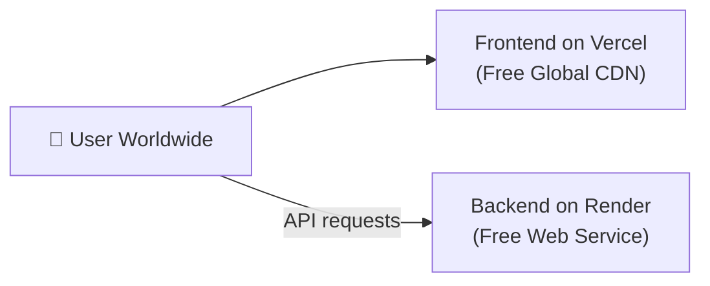

# FileForge — Mobile Download & Hosting Guide

This guide walks you through:
1. **Downloading & Installing the Web App on Mobile/Desktop (PWA)**
2. **Testing on Mobile Right Now over Wi-Fi (No Deployment Needed)**
3. **Hosting FileForge on the Cloud (Free & Production Options)**

---

## Part 1: How to Download & Install on Devices (PWA)

FileForge is built as an installable **Progressive Web App (PWA)**. It can be installed directly onto your device's home screen or desktop without using Google Play or the App Store.

### 📱 On Android (Chrome, Brave, Edge)
1. Open the website in Chrome or Brave.
2. An **"Install App"** button appears in the FileForge header (or a bottom prompt "Add FileForge to Home screen").
3. Tap **Install App** → tap **Install**.
4. The FileForge app icon will appear on your Home Screen and in your App Drawer.
5. It opens in its own standalone window (no browser address bar) and runs like a native Android app.

### 🍏 On iPhone / iPad (Safari)
1. Open the website in **Safari**.
2. Tap the **Share** button (the square with an arrow pointing upward at the bottom of the screen).
3. Scroll down the menu and tap **Add to Home Screen** (`+`).
4. Tap **Add** in the top right corner.
5. The FileForge icon is now on your home screen. When tapped, it opens in full-screen standalone mode.

### 💻 On Windows / Mac / Linux (Chrome, Edge, Brave)
1. Open the website.
2. Look at the right side of the browser's address bar for the **Install App icon** (monitor with down arrow), or click the **"Install App"** button in the FileForge header.
3. Click **Install**.
4. FileForge is added to your Start Menu / Applications folder and can be pinned to your Taskbar or Dock.

---

## Part 2: Test on Your Phone Right Now (Over Wi-Fi)

You don't need to deploy to test on your phone today. You can load it directly from your computer over your local Wi-Fi:

### Step 1: Find your computer's local IP address
In PowerShell on your computer, run:
```powershell
ipconfig
```
Look for **IPv4 Address** under your Wi-Fi adapter (e.g. `192.168.1.15`).

### Step 2: Start the servers binding to all network interfaces
1. **Backend**:
   ```powershell
   cd backend
   uvicorn main:app --host 0.0.0.0 --port 8000
   ```
2. **Frontend**:
   ```powershell
   cd frontend
   npm run dev -- --host
   ```

### Step 3: Open on your phone
On your phone (connected to the same Wi-Fi), open your mobile browser and type:
```
http://192.168.1.15:5173
```
*(Replace `192.168.1.15` with your actual computer IP)*

You can now upload camera photos or files directly from your phone and test the UI and downloads!

---

## Part 3: Hosting Worldwide (Cloud Deployment)

### Method A: The Recommended Free Route (Vercel + Render)



#### Step 1: Push your project to GitHub
1. Create a repository on [GitHub](https://github.com).
2. Push your project:
   ```bash
   git init
   git add .
   git commit -m "Initial FileForge commit"
   git branch -M main
   git remote add origin https://github.com/your-username/fileforge.git
   git push -u origin main
   ```

#### Step 2: Deploy the Backend on Render
1. Go to [Render.com](https://render.com) and create a free account.
2. Click **New +** → **Web Service**.
3. Connect your GitHub repository.
4. Settings:
   - **Root Directory**: `backend`
   - **Environment**: `Python 3`
   - **Build Command**: `pip install -r requirements.txt`
   - **Start Command**: `uvicorn main:app --host 0.0.0.0 --port $PORT`
5. Click **Create Web Service**. Render will give you a public URL like:
   `https://fileforge-backend.onrender.com`

#### Step 3: Deploy the Frontend on Vercel
1. Go to [Vercel.com](https://vercel.com) and sign in with GitHub.
2. Click **Add New Project** → Import your repo.
3. Settings:
   - **Root Directory**: `frontend`
   - **Framework Preset**: `Vite`
4. Expand **Environment Variables**:
   - Key: `VITE_API_BASE`
   - Value: `https://fileforge-backend.onrender.com` *(your Render backend URL)*
5. Click **Deploy**. Vercel gives you your live production URL:
   `https://fileforge.vercel.app`

---

### Method B: 1-Click Containerized VPS (DigitalOcean / Hetzner / AWS)
*Best for heavy video/audio processing at a fixed $4–$6/month.*

1. Rent a server on [Hetzner](https://www.hetzner.com) ($4/mo) or [DigitalOcean](https://www.digitalocean.com) ($6/mo).
2. SSH into your server:
   ```bash
   ssh root@your-server-ip
   ```
3. Install Docker:
   ```bash
   curl -fsSL https://get.docker.com | sh
   ```
4. Clone and launch FileForge:
   ```bash
   git clone https://github.com/your-username/fileforge.git
   cd fileforge
   docker compose up -d --build
   ```
5. FileForge is live on `http://your-server-ip` with Nginx, rate limiting, and Redis queue pre-configured.

